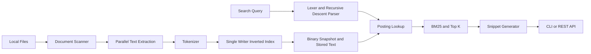

# Local Full-Text Search Engine

A local full-text search engine built from scratch in Java using an inverted
index and BM25 ranking.

Index your notes and source code once, then search posting lists rather than
rescanning your source files. Everything stays local. No search server, Lucene,
external account, telemetry, or query history is involved.

## Features

- Unicode tokenization, source identifier aliases, and optional stop words
- Positional inverted index with term and document frequencies
- BM25 ranking, bounded top-K selection, relevant snippets and highlight offsets
- Exact phrases, boolean expressions, parentheses, and trailing prefix wildcards
- File extension, path substring, and minimum relevance filters
- Versioned, checksummed binary snapshots and atomic publication
- Incremental new/modified/unchanged/deleted file handling with stable IDs
- Bounded concurrent extraction and single-threaded posting merges
- UTF-8 text and PDFBox text extraction
- Named indexes, JSON output, measured statistics and latency benchmarks
- Loopback-only, read-only REST API with optional relative paths
- JUnit tests and a Java 21 CI matrix for Windows, Linux, and macOS

## Why Build a Search Engine?

This project explores the data structures and algorithms behind information
retrieval: turning text into terms, mapping terms to documents, composing query
constraints, and ranking the resulting candidates. It is a small, inspectable
implementation intended for learning and local collections.

## Installation

Requirements: **Java 21+** and **Maven 3.9+** on PATH.

```sh
java -version
mvn -version
mvn clean package
java -jar target/local-full-text-search-engine.jar --help
java -jar target/local-full-text-search-engine.jar --version
```

The shaded executable JAR includes its runtime dependencies. The repository
name suggested for publication is `local-full-text-search-engine`.

## Quick Start

```sh
java -jar target/local-full-text-search-engine.jar index examples/documents
java -jar target/local-full-text-search-engine.jar search "distributed systems"
java -jar target/local-full-text-search-engine.jar search "database index" --json
java -jar target/local-full-text-search-engine.jar info
java -jar target/local-full-text-search-engine.jar update
```

Indexes live under `.search-index/default` in the current directory. Run later
commands from the same directory, or provide an explicit `--index-dir`.

## CLI Commands and Flags

Global options work before or after the command:

| Option | Meaning |
| --- | --- |
| `--index-dir PATH` | Base directory containing named indexes |
| `--index NAME` / `--name NAME` | Select index; default `default` |
| `--config PATH` | Properties file; default `~/.local-search/config.properties` |
| `--debug` | Diagnostic stack traces to stderr |
| `--help`, `--version` | Usage and application version |

| Command | Options / behavior |
| --- | --- |
| `index PATH` | `--exclude GLOB` (repeatable), `--max-file-size 20MB`, `--threads 1..128`, `--stop-words FILE` |
| `update` | Reuse saved root, size limit, exclusions and stop words; optional `--threads` |
| `search QUERY` | `--top 1..1000`, `--type md`, `--path university/`, `--min-score 0`, `--json`, `--no-color` |
| `info` | Root, dates, documents, vocabulary, tokens, average length, disk bytes |
| `stats` | Info plus counts by type, ten largest files, twenty most frequent terms |
| `list-documents` | Saved document metadata as JSON |
| `delete-index` | Confirmation required; `--yes` for scripted confirmation |
| `serve` | `--port 8080`, `--hide-paths` |
| `benchmark` | `--queries FILE`, `--iterations 100`, `--warmup 10` |

```sh
java -jar target/local-full-text-search-engine.jar index ./notes --name university --exclude logs --exclude "**/generated" --max-file-size 20MB --threads 4
java -jar target/local-full-text-search-engine.jar search "database" --index university --type md --top 20
```

Exclusions match either an entry's basename or its path relative to the source
root, using the host filesystem's Java NIO glob rules. Shell quoting prevents
the shell from expanding wildcards. Default skipped directories are `.git`,
`.idea`, `.vscode`, `node_modules`, `target`, `build`, `dist`, `.venv`, `venv`,
`__pycache__`, `.search-index`, and `.tools`. The active index directory is also
excluded. Directory symlinks are never followed; symlink files are skipped.

Supported files: `.txt`, `.md`, `.java`, `.py`, `.js`, `.ts`, `.json`, `.xml`,
`.yaml`, `.yml`, `.properties`, `.csv`, and `.pdf`. Structured formats are indexed
as plain text; they are never executed. Text must be UTF-8. Malformed text,
binary content, unreadable files and oversized files produce warnings in the
index report. The default source file limit is 10 MiB, including PDFs.

Metadata/reporting commands emit JSON. `search --json` writes JSON only to
stdout; errors go to stderr. ANSI highlighting is enabled only for an attached
terminal when picocli detects support and `--no-color` is absent. Exit codes:
`0` success, `1` application/I/O error, `2` invalid arguments/query, `3` missing
index. `delete-index` removes only recognized generated filenames; it keeps
the directory and lock file and never deletes source documents.

## Architecture



File workers return independent extraction results. The coordinator merges
results in a deterministic order. A filesystem lock prevents two index writers
from publishing at once. Search loads a committed snapshot; it never touches
source documents. The API caches a snapshot and checks the small `CURRENT`
pointer on each request, so subsequent requests see completed CLI updates.

## Tokenization

Words contain Unicode letters, numbers, combining marks and underscores. Case
normalization uses `Locale.ROOT` after Unicode NFKC normalization. Original text
and UTF-16 character offsets are preserved for snippets and highlight spans.

`get_user_by_id` emits `get_user_by_id`, `get`, `user`, `by`, `id`.
`getUserById` emits `getuserbyid`, `get`, `user`, `by`, `id`.
`HTTPServer` also emits `http` and `server`. Aliases share the original word's
position and duplicate aliases at that position are removed. Document length
counts original lexical words, rather than inflating it with aliases.

Words longer than 256 UTF-16 units are not indexed, but still consume a
position, preventing false phrase adjacency. Query tokens over this limit are
rejected. Russian and Kazakh text use the same tokenizer. There is no stemming
or suffix stripping. Stop words are disabled by default. A UTF-8 file with one
word per line can enable them at index creation; they cannot change on an
existing populated index. Removing stop words preserves positional gaps, but
phrases containing removed words cannot match. Avoid filtering words when
exact quotations matter.

## Inverted Index

The vocabulary is a sorted `TreeMap`. Each term maps document IDs to postings:

```text
Document 1: java search java
Document 2: java networking

java       -> 1: [0, 2], 2: [0]
search     -> 1: [1]
networking -> 2: [1]
```

Term frequency (TF) is the posting's position count. Document frequency (DF) is
the number of documents in that term's posting list. Collection frequency is
the sum of TF over documents. Statistics report both DF and collection frequency.

## Positional Index and Phrase Search

For `"distributed systems"`, intersect the two posting lists and require a
position of `systems` exactly one after a position of `distributed`. Longer
phrases require offsets `+1`, `+2`, etc. Position membership uses binary search.
`systems for distributed computing` therefore does not match. Identifier
aliases may match one phrase word, but aliases at the same position cannot
pretend to be consecutive words. Phrases operate on normalized words, not raw
punctuation or case.

## BM25

For each unique positive query term `t`, the scorer computes:

```text
IDF(t) = ln(1 + (N - df(t) + 0.5) / (df(t) + 0.5))
score(D,Q) = sum over t in Q:
    IDF(t) * tf(t,D) * (k1 + 1)
    / (tf(t,D) + k1 * (1 - b + b * length(D) / avgdl))
```

`N` is corpus size; `avgdl` is mean lexical document length. IDF rewards rarer
terms, TF has diminishing returns, and length normalization avoids rewarding
long documents merely for containing more text. Defaults are `k1=1.2` and
`b=0.75`, configurable in properties. Empty documents are included in `N` and
the average; an all-empty corpus scores zero. Negated-only matches score zero.
Phrase constraints determine eligibility; their constituent terms contribute
BM25 without an artificial phrase boost. Repeated query words count once.

**BM25 is a relevance score, not a percentage, probability, or confidence value.**

Scores accumulate by traversing positive-term postings for candidate documents.
A priority queue retains the best K results in `O(C log K)` after scoring, where
`C` is the filtered candidate count. Ties use ascending path order.

## Query Syntax

| Query | Meaning |
| --- | --- |
| `database indexing` | Implicit OR, ranked by BM25 |
| `"distributed systems"` | Exact normalized phrase |
| `"distributed systems" reliability` | Phrase OR term |
| `"distributed systems" AND reliability` | Require both |
| `java AND networking` | Intersection |
| `python OR java` | Union |
| `database NOT mysql` | Database excluding mysql |
| `(java OR python) AND backend` | Parenthesized grouping |
| `distrib*` | Vocabulary prefix expansion |

Operators are uppercase; lowercase `and`, `or`, `not` remain searchable words.
Precedence is `NOT`, then `AND`, then `OR`; adjacent `NOT` implies AND, other
adjacent operands imply OR. A lexer recognizes operators, parentheses and
quoted phrases; a recursive-descent parser builds a sealed query AST. Invalid
syntax gets an actionable error. Only trailing `*` is supported; no escaping,
infix wildcards, field expressions, or fuzzy operators are implemented.
Queries are capped at 4096 characters and 256 syntax tokens.

Prefix lookup seeks into the sorted vocabulary and walks only the matching
range: `O(log V + M)` vocabulary work, plus matching postings. It never scans
source files. Expansion beyond 10,000 terms is rejected; use a longer prefix.
Type and path filters operate on candidate metadata. `--path` is a literal
substring after converting separators to `/`, rather than a filesystem access
or glob. `--min-score` must be finite and nonnegative.

In POSIX shells and PowerShell, preserve phrase quotes with a single-quoted
outer argument:

```sh
java -jar target/local-full-text-search-engine.jar search '"distributed systems"'
java -jar target/local-full-text-search-engine.jar search '(java OR python) AND backend'
```

Windows PowerShell 5 can strip embedded quotes. This tested stop-parsing form
passes them intact (keep all arguments after `--%` on the same line):

```powershell
java -jar target/local-full-text-search-engine.jar search --% "\"distributed systems\"" --json
```

## Snippets

Only the top K documents' stored text is opened. The first positive term
occurrence anchors roughly 80 characters before and 160 after, adjusted toward
word boundaries with a hard bound on unusually long following words. Ellipses
mark truncation. A negative-only query falls back to initial context. JSON
includes plain text and UTF-16 `highlights` offsets suitable for JavaScript
substring operations; CLI output can add ANSI colors. Identifier aliases
highlight the full identifier. No HTML is emitted or trusted.

## Persistent Index Format

```text
.search-index/default/
  CURRENT                       # snapshot filename; atomic commit pointer
  write.lock                    # operating-system writer lock
  snapshot-<uuid>.bin            # explicit binary snapshot
  content/<uuid>.txt            # original extracted UTF-8 text
```

All integers use Java `DataOutputStream` big-endian encoding. A snapshot has:

1. 32-bit magic `0x4C465453` and 32-bit format version `1`.
2. Root string, created/updated epoch-millisecond longs, next stable document ID.
3. Maximum source size, stop-word list, exclusion list.
4. Document count and records: ID, path, filename, extension, size, modified
   timestamp, SHA-256, lexical token count, stored-content filename.
5. Vocabulary count; for each term: UTF-8 string and document frequency; each
   posting: document ID, frequency, then that many absolute integer positions.
6. CRC32 of all preceding bytes, stored as a 64-bit long.

Strings use a 32-bit byte length followed by UTF-8; lists start with a 32-bit
count. No Java object serialization is used. The reader validates signature,
version, lengths, IDs, positions, checksum and trailing bytes. Corrupt or
unsupported indexes produce a readable error; they are never silently reset.
Missing or damaged stored text produces a search I/O error.

Content is written under fresh names and flushed; a complete snapshot is
written, flushed and forced to disk. A temporary pointer is forced and renamed
using `ATOMIC_MOVE`. A filesystem without atomic rename fails the update,
preserving the previous pointer. The old committed snapshot remains intact
until publication succeeds. This provides process-crash-safe publication;
strict power-loss durability of directory entries is filesystem-dependent.

Old generations and unreferenced text are retained so active readers can finish
without races. `info.indexBytes` includes that history. Rebuild into another
named index and delete the old index to reclaim space. This deliberately trades
disk space for a simple reader lifecycle; background compaction is future work.

## Incremental Indexing

- **New:** assign a monotonically increasing ID, hash, extract, tokenize, merge.
- **Unchanged:** same size and mtime skips reading content entirely. If metadata
  changed but streamed SHA-256 is identical, update metadata without extracting.
- **Modified:** preserve ID, replace postings and stored text. Metadata and a
  second hash detect changes during extraction; retry on the next update.
- **Deleted/excluded/now oversized:** remove metadata and postings after a
  successful scan. Failed access to a subtree protects its existing documents.

An individual extraction error retains the last successfully indexed version
and is reported in `warnings`; a failed root scan does not publish an update.
Use `update` to reuse saved settings. Indexing a different root or changing
stop words requires another named index. Size/mtime is a fast-path heuristic:
content changed while deliberately preserving both metadata fields will be
missed; build a fresh index when strict verification is required.

## Concurrency and Memory

`--threads` controls a bounded platform-thread pool. Work is submitted in batches
of that size, preventing an unbounded extraction queue. Each worker reads,
extracts, hashes and tokenizes independently; only the coordinator mutates
postings. This avoids unsafe concurrent collections and limits simultaneous
large PDFs. Virtual threads are not used: a fixed pool makes memory limits
easier to reason about for CPU-heavy PDF extraction.

Vocabulary, metadata and positional postings reside in memory; document text
lives on disk. Only a bounded worker batch and the top search results' text are
loaded. Snippet generation currently tokenizes each selected document in full.
The engine targets thousands of ordinary local text files, rather than
unbounded corpora or enormous documents.

## PDF Extraction

Apache PDFBox 3 loads PDFs and `PDFTextStripper` extracts text in reading order.
Text is stored independently of the original PDF. Empty/scanned PDFs are skipped
with an OCR explanation; encrypted or malformed PDFs are reported as extraction
failures. Extracted text above 20 million characters is rejected after
extraction. There is no OCR or page-number metadata. PDFs with unusual layouts
may have imperfect reading order and phrase boundaries.

## REST API

```sh
java -jar target/local-full-text-search-engine.jar serve --port 8080 --hide-paths
```

The JDK HTTP server binds only to the loopback interface and uses eight request
workers. No index mutation is exposed over HTTP. Stop using Ctrl+C; the JVM
shutdown hook closes the listener and workers.

| Endpoint | Response |
| --- | --- |
| `GET /health` | Liveness, even without an index |
| `GET /api/search?q=java&limit=10` | Query, hits, durationMs, ranked results |
| `GET /api/index/info` | Index information |
| `GET /api/stats` | Index statistics |

Search accepts `type`, `path`, and `minScore` parameters. Limits are 1..1000.
Errors are JSON: invalid requests `400`, missing index/route `404`, unsupported
methods `405`, unreadable index `500`. `--hide-paths` returns paths relative to
the indexed root and replaces that root with `.` in metadata. Source content
and snippets may themselves contain private information; use only on a trusted
local machine. This is a local development API with no authentication or TLS.

## Configuration

See [examples/config.properties](examples/config.properties). Supported keys are
`index.directory`, `search.top`, `bm25.k1`, `bm25.b`, `max.file.size`, `threads`,
and comma-separated `exclude`. Explicit CLI flags override defaults; saved
extraction settings take precedence during updates. There are no global machine
configuration changes or stored search histories.

## Benchmarking

```sh
java -jar target/local-full-text-search-engine.jar benchmark --queries examples/queries.txt --iterations 100 --warmup 10
```

Without a query file, up to twenty actual vocabulary terms are used. Warmup
requests are excluded; elapsed time uses `System.nanoTime`. The JSON report
contains actual average, median, P95, P99, min and max milliseconds. Percentiles
use nearest rank: `sorted[ceil(p*N)-1]`. Measurements include query parsing,
ranking and snippet I/O, and exclude the initial index load and CLI startup.
Repeated queries use OS/JVM caches; sample-corpus results are a smoke benchmark,
not a production performance claim. No timing threshold is asserted by tests.

## Project Structure

```text
src/main/java/dev/localsearch/
  cli/           picocli commands
  document/      NIO scanner, extraction, immutable metadata
  text/          Unicode tokenizer and identifier aliases
  index/         positional postings and incremental writer
  search/        BM25, candidate evaluation, snippets, top K
    query/       lexer, recursive-descent parser, sealed AST
  storage/       versioned checksummed binary snapshots
  server/        read-only HTTP API
  benchmark/     measured latency and nearest-rank percentiles
  util/          JSON, configuration, index statistics
src/test/java/dev/localsearch/
examples/documents/
examples/queries.txt
examples/config.properties
.github/workflows/ci.yml
```

## Dependencies

| Dependency | Purpose |
| --- | --- |
| picocli | CLI parsing, help, validation and terminal capability detection |
| Jackson databind | JSON output for CLI and HTTP |
| Apache PDFBox | PDF text extraction and generated PDF tests |
| SLF4J simple | Diagnostic logging to stderr |
| JUnit Jupiter | Deterministic unit and integration tests |

The HTTP API uses the JDK `HttpServer`, avoiding a web framework dependency.
No library implements the inverted index, parser, scoring or persistence.

## Testing

```sh
mvn test
mvn clean package
```

For a fresh-process end-to-end check after packaging:

```sh
java --class-path target/local-full-text-search-engine.jar scripts/Verify.java
```

This checks the executable, independent-process persistence, incremental
add/modify/delete handling, a generated PDF, HTTP endpoints, and sample plus
2,000-document synthetic benchmarks. Its temporary corpus is removed afterward;
the sanitized report is saved to `target/verification.txt`.

Tests use JUnit `@TempDir` exclusively for corpus/index files. Coverage includes
Unicode, identifiers, long words, normalization, postings and positions, TF/DF,
BM25 numerical values and ranking, parser errors and precedence, boolean and
phrase retrieval, prefix expansion, filters, snippets, incremental lifecycle,
fresh-instance persistence, corruption, failed updates, concurrent synthetic
corpora, generated text PDFs, API privacy/validation, CLI exit codes and valid
JSON. API tests use ephemeral ports and no internet. CI targets Java 21.

## What I Learned

The implementation makes Java NIO traversal and filesystem failures explicit;
separates original text from normalized retrieval terms; uses postings and
positional joins to avoid corpus scans; and connects BM25's TF, DF and length
normalization to testable ranking behavior. It also explores recursive-descent
parsing, versioned binary formats, atomic publication, controlled concurrency,
incremental updates, REST boundaries, and deterministic JUnit integration tests.
Bounded platform workers illustrate a different resource tradeoff from Java
21 virtual threads.

## Limitations

- Local/portfolio scale; all metadata and postings must fit the JVM heap.
- Not intended to replace Lucene or Elasticsearch; no distributed index.
- Old snapshots/text need explicit index replacement/deletion to reclaim space.
- No OCR, DOCX, stemming, fuzzy matching, semantic vectors, or desktop/web UI.
- Phrase matching depends on lexical boundaries and extracted PDF reading order.
- Metadata-only unchanged detection can miss same-size, same-mtime edits.
- Stored documents duplicate searchable text on disk; snippets scan selected text.
- Writer updates rewrite the binary snapshot; modified-document removal visits
  vocabulary lists. Large update-heavy collections would benefit from segments.
- CRC32 detects accidental snapshot corruption, not hostile modification; stored
  content has no independent checksum validation on every search.
- Local files are trusted input; limits reduce accidental resource consumption
  but are not a hardened sandbox for adversarial PDFs or hostile index files.

## Future Improvements

Segmented indexes, generation garbage collection with reader tracking,
compressed/delta-encoded postings, stored snippet offsets, memory mapping,
always-hash verification mode, PDF page metadata, fuzzy search and spelling
correction, language-aware stemming, faceting, OCR, a desktop UI, and a measured
comparison with Lucene would be useful next steps. Hybrid BM25/vector retrieval
is a separate future extension.

## Suggested Natural Commits

1. Initial Maven project and CLI setup
2. Add document discovery, extraction and Unicode tokenization
3. Implement positional inverted index and BM25 ranking
4. Add phrase/boolean parser, prefix queries, snippets and filters
5. Add binary persistence, incremental updates and concurrent extraction
6. Add read-only REST API and benchmark command
7. Add comprehensive tests, examples, CI and documentation

No commits or remote pushes are created automatically.

## License

[MIT](LICENSE), copyright 2026.
